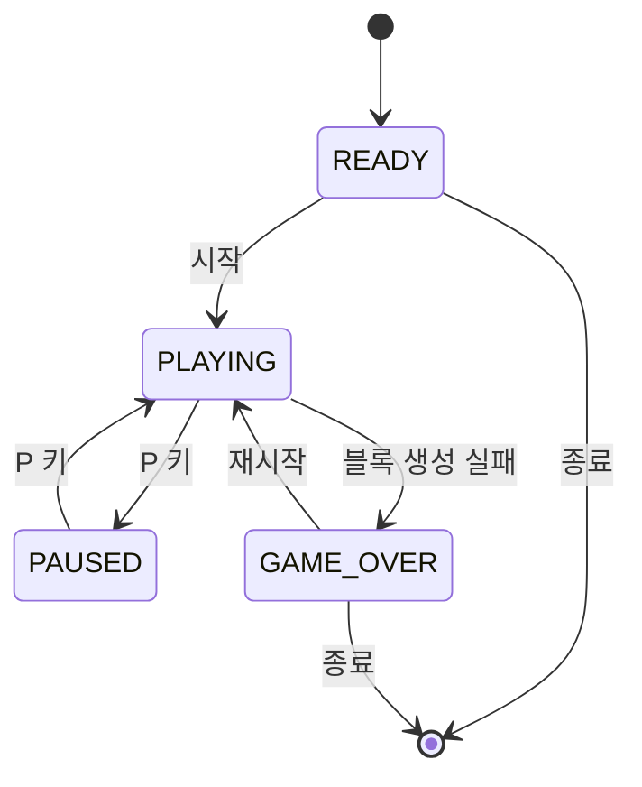

# 요구사항 명세서
# 파이썬 입문자를 위한 테트리스(Tetris) 게임 개발 상세 기능 명세서

개발 기획 및 기능 명세서 Python 초급자 대상

## 1. 프로젝트 개요

### 1.1 프로젝트명

Python Tetris Game (파이썬 테트리스 게임)

### 1.2 프로젝트 목적

파이썬 프로그래밍 입문자가 게임 개발의 기본적인 구조와 원리를 학습할 수 있도록 클래식 테트리스 게임을 개발한다.

게임 개발 과정에서 다음과 같은 파이썬 프로그래밍 개념을 자연스럽게 익히는 것을 목표로 한다.

- 변수와 자료형
- 조건문과 반복문
- 함수와 클래스
- 리스트 및 2차원 배열
- 객체지향 프로그래밍(OOP)
- 키보드 이벤트 처리
- 게임 루프(Game Loop)
- 충돌 감지 및 좌표 처리
- 화면 렌더링 및 애니메이션
- 점수 계산 및 게임 상태 관리

### 1.3 개발 환경

| 구분 | 내용 |
| --- | --- |
| 프로그래밍 언어 | Python 3.10 이상 |
| 게임 라이브러리 | Pygame |
| 개발 도구 | Visual Studio Code |
| 운영체제 | Windows 10/11, macOS |
| 화면 해상도 | 800 × 700 픽셀 |
| 게임 유형 | 2D 퍼즐 게임 |
| 실행 방식 | PC 데스크톱 애플리케이션 |

### 1.4 개발 범위

초급자가 단계별로 개발할 수 있도록 필수 기능과 확장 기능을 구분한다.

| 구분 | 기능 | 우선순위 |
| --- | --- | --- |
| 기본 | 게임 화면 구성 | 필수 |
| 기본 | 테트리스 블록 생성 | 필수 |
| 기본 | 블록 좌우 이동 | 필수 |
| 기본 | 블록 회전 | 필수 |
| 기본 | 블록 자동 하강 | 필수 |
| 기본 | 바닥 및 블록 충돌 감지 | 필수 |
| 기본 | 블록 고정 및 줄 제거 | 필수 |
| 기본 | 점수 계산 | 필수 |
| 기본 | 게임 오버 처리 | 필수 |
| 기본 | 게임 재시작 | 필수 |
| 확장 | 다음 블록 미리 보기 | 권장 |
| 확장 | 일시 정지 | 권장 |
| 확장 | 레벨 시스템 | 권장 |
| 확장 | 최고 점수 저장 | 선택 |
| 확장 | 배경 음악 및 효과음 | 선택 |

## 2. 게임 기본 규칙

### 2.1 게임 진행 방식

테트리스는 다양한 모양의 블록을 위에서 아래로 떨어뜨려 가로줄을 완성하는 퍼즐 게임이다.

Forget 3-D Chess and Try 4-Directional Tetris\! | PuzzCulture

'Tetris' film adaptation moves forward, billed as a 'sci-fi thriller' - UPI.com

Tetris | ELMCIP

게임은 다음 순서로 진행한다.

1. 새로운 테트리스 블록이 게임 화면 상단에 생성된다.
2. 블록은 일정한 시간 간격으로 자동 하강한다.
3. 플레이어는 키보드로 블록을 좌우로 이동하거나 회전한다.
4. 블록이 바닥 또는 다른 블록과 충돌하면 현재 위치에 고정된다.
5. 가로줄이 모두 채워지면 해당 줄을 제거한다.
6. 제거한 줄 수에 따라 점수를 획득한다.
7. 새로운 블록이 생성되고 게임이 계속 진행된다.
8. 새로운 블록을 생성할 공간이 없으면 게임 오버가 된다.

### 2.2 테트리스 블록 종류

테트리스는 총 7가지 기본 블록을 사용한다.

| 블록 | 모양 | 설명 |
| --- | --- | --- |
| I | 일자형 | 가로 또는 세로 4칸 |
| O | 정사각형 | 2 × 2 형태 |
| T | T자형 | 중앙에 돌출된 형태 |
| S | S자형 | 오른쪽 위로 꺾인 형태 |
| Z | Z자형 | 왼쪽 위로 꺾인 형태 |
| J | J자형 | 왼쪽에 돌출된 형태 |
| L | L자형 | 오른쪽에 돌출된 형태 |

각 블록은 4개의 정사각형으로 구성하며, 회전 기능을 지원한다.

### 2.3 게임 보드 규격

- 가로: 10칸
- 세로: 20칸
- 각 칸 크기: 30 × 30 픽셀
- 게임 보드 크기: 300 × 600 픽셀

Tetris game rules and program algorythm. | PPTX

게임 보드는 2차원 리스트로 구현한다.

python

```python
BOARD_WIDTH = 10
BOARD_HEIGHT = 20

board = [
    [0 for _ in range(BOARD_WIDTH)]
    for _ in range(BOARD_HEIGHT)
]
```

각 셀의 값은 다음과 같이 정의한다.

- `0`: 빈 공간
- `1~7`: 각 테트리스 블록 종류
- 블록이 고정되면 해당 위치에 블록 번호를 저장한다.

## 3. 게임 화면 구성 명세

### 3.1 전체 화면 레이아웃

게임 화면은 크게 세 가지 영역으로 구성한다.

Free tetris - shortcaqwe

[shortcaqwe.weebly.com](<https://shortcaqwe.weebly.com/free-tetris.html?utm_source=chatgpt.com>)

| 영역 | 구성 요소 | 설명 |
| --- | --- | --- |
| 좌측 | 게임 보드 | 블록이 생성되고 하강하는 영역 |
| 우측 상단 | NEXT BLOCK | 다음에 등장할 블록 표시 |
| 우측 중간 | SCORE | 현재 점수 표시 |
| 우측 중간 | LEVEL | 현재 레벨 표시 |
| 우측 하단 | LINES | 제거한 줄 수 표시 |
| 전체 | 배경 | 게임 전체 배경 화면 |

### 3.2 화면 구성 상세

① 게임 보드 영역

- 10 × 20 크기의 격자를 표시한다.
- 현재 움직이는 블록을 표시한다.
- 이미 고정된 블록을 표시한다.
- 각 블록은 종류에 따라 다른 색상을 사용한다.
- 블록 사이에 격자선을 표시한다.

② NEXT BLOCK 영역

- 다음에 등장할 블록을 미리 표시한다.
- 다음 블록의 모양과 색상을 표시한다.
- 블록이 새로 생성되면 다음 블록을 갱신한다.

③ SCORE 영역

- 현재 획득한 점수를 표시한다.
- 줄 제거 시 점수를 갱신한다.
- 게임 재시작 시 점수를 초기화한다.

④ LEVEL 영역

- 현재 게임 레벨을 표시한다.
- 일정한 줄 수를 제거하면 레벨을 증가시킨다.
- 레벨이 올라갈수록 블록의 하강 속도를 증가시킨다.

⑤ LINES 영역

- 지금까지 제거한 전체 줄 수를 표시한다.
- 줄 제거 시 누적 수치를 갱신한다.

## 4. 상세 기능 명세

이 부분은 실제 개발 시 기능별 구현 기준으로 활용한다.

### 4.1 게임 시작 기능

| 항목 | 상세 내용 |
| --- | --- |
| 기능 ID | F-001 |
| 기능명 | 게임 시작 |
| 설명 | 게임을 처음 실행하거나 새 게임을 시작한다. |
| 입력 | 마우스 클릭 또는 키보드 입력 |
| 처리 | 게임 데이터 초기화 및 첫 블록 생성 |
| 출력 | 게임 보드 및 점수 표시 |
| 예외 처리 | 초기화 실패 시 오류 메시지 표시 |

세부 요구사항

1. 프로그램 실행 시 게임 초기 화면을 표시한다.
2. 시작 버튼을 표시한다.
3. 시작 버튼 클릭 시 게임을 시작한다.
4. 게임 보드를 빈 상태로 초기화한다.
5. 점수를 0점으로 초기화한다.
6. 레벨을 1로 설정한다.
7. 첫 번째 블록을 생성한다.

### 4.2 블록 생성 기능

| 항목 | 상세 내용 |
| --- | --- |
| 기능 ID | F-002 |
| 기능명 | 블록 생성 |
| 설명 | 7가지 블록 중 하나를 무작위로 생성한다. |
| 입력 | 블록 생성 요청 |
| 처리 | 블록 종류 무작위 선택 |
| 출력 | 게임 보드 상단에 블록 표시 |
| 예외 처리 | 생성 위치가 점유된 경우 게임 오버 |

세부 요구사항

1. 7가지 블록 중 하나를 선택한다.
2. 블록별 모양과 색상을 지정한다.
3. 게임 보드 상단 중앙에 블록을 생성한다.
4. 생성된 블록의 초기 회전 상태를 설정한다.
5. 생성된 블록의 좌표를 관리한다.
6. 블록 생성 위치에 다른 블록이 존재하면 게임 오버 처리한다.

블록 데이터 예시

python

```python
SHAPES = {
    "I": [[1, 1, 1, 1]],

    "O": [
        [1, 1],
        [1, 1]
    ],

    "T": [
        [0, 1, 0],
        [1, 1, 1]
    ],

    "S": [
        [0, 1, 1],
        [1, 1, 0]
    ],

    "Z": [
        [1, 1, 0],
        [0, 1, 1]
    ],

    "J": [
        [1, 0, 0],
        [1, 1, 1]
    ],

    "L": [
        [0, 0, 1],
        [1, 1, 1]
    ]
}
```

### 4.3 블록 좌우 이동 기능

| 항목 | 상세 내용 |
| --- | --- |
| 기능 ID | F-003 |
| 기능명 | 블록 좌우 이동 |
| 설명 | 현재 블록을 왼쪽 또는 오른쪽으로 이동한다. |
| 입력 | 키보드 방향키 |
| 처리 | 블록의 X 좌표 변경 |
| 출력 | 변경된 위치에 블록 표시 |
| 예외 처리 | 벽이나 다른 블록과 충돌하면 이동 취소 |

세부 요구사항

- 왼쪽 방향키를 누르면 X 좌표를 1 감소시킨다.
- 오른쪽 방향키를 누르면 X 좌표를 1 증가시킨다.
- 이동 전에 충돌 여부를 검사한다.
- 벽이나 고정된 블록이 존재하면 이동하지 않는다.
- 키를 누르고 있는 동안 반복 이동을 지원할 수 있다.

python

```python
# 왼쪽 이동
current_x -= 1

# 오른쪽 이동
current_x += 1
```

실제 구현에서는 좌표를 먼저 변경한 뒤 충돌 검사에 실패하면 원래 좌표로 복구한다.

### 4.4 블록 회전 기능

| 항목 | 상세 내용 |
| --- | --- |
| 기능 ID | F-004 |
| 기능명 | 블록 회전 |
| 설명 | 현재 블록을 시계 방향으로 90도 회전한다. |
| 입력 | 위쪽 방향키 |
| 처리 | 2차원 리스트 회전 |
| 출력 | 회전된 블록 표시 |
| 예외 처리 | 회전 후 충돌 발생 시 회전 취소 |

세부 요구사항

1. 위쪽 방향키 입력을 감지한다.
2. 현재 블록의 모양을 회전한다.
3. 회전 후 보드 경계를 검사한다.
4. 다른 블록과 겹치는지 검사한다.
5. 정상적인 회전이면 적용한다.
6. 충돌하면 원래 모양으로 복구한다.

2차원 리스트 회전 예시:

python

```python
rotated_shape = [
    list(row)
    for row in zip(*shape[::-1])
]
```

초급 버전에서는 회전 시 벽에 걸리면 회전을 취소하는 방식으로 구현한다. 이후 확장 버전에서는 벽 차기(Wall Kick)를 추가할 수 있다.

### 4.5 블록 자동 하강 기능

| 항목 | 상세 내용 |
| --- | --- |
| 기능 ID | F-005 |
| 기능명 | 블록 자동 하강 |
| 설명 | 일정 시간 간격으로 블록을 아래로 이동시킨다. |
| 입력 | 게임 시간 및 레벨 |
| 처리 | Y 좌표 증가 |
| 출력 | 아래쪽으로 이동한 블록 |
| 예외 처리 | 하강할 수 없으면 블록 고정 |

세부 요구사항

- 게임이 진행 중일 때만 자동 하강한다.
- 기본 하강 간격은 1초로 설정한다.
- 일정 시간마다 Y 좌표를 1 증가시킨다.
- 하강 위치에 충돌이 발생하면 블록을 고정한다.
- 블록 고정 후 새로운 블록을 생성한다.
- 레벨이 올라가면 하강 속도를 증가시킨다.

python

```python
import time

fall_interval = 1.0
last_fall_time = time.time()

if time.time() - last_fall_time >= fall_interval:
    current_y += 1
    last_fall_time = time.time()
```

실제 게임에서는 Pygame의 시간 관리 기능을 활용하는 것이 좋다.

### 4.6 빠른 하강 기능 (Hard Drop)

| 항목 | 상세 내용 |
| --- | --- |
| 기능 ID | F-006 |
| 기능명 | 빠른 하강 |
| 설명 | 현재 블록을 충돌 지점까지 즉시 하강시킨다. |
| 입력 | 스페이스바 |
| 처리 | 더 이상 이동할 수 없을 때까지 하강 |
| 출력 | 블록 고정 및 점수 갱신 |

세부 요구사항

1. 스페이스바 입력을 감지한다.
2. 현재 블록이 이동할 수 있는지 확인한다.
3. 이동할 수 있다면 아래로 한 칸 이동한다.
4. 충돌이 발생할 때까지 반복한다.
5. 최종 위치에 블록을 고정한다.
6. 새로운 블록을 생성한다.

### 4.7 블록 충돌 감지 기능

| 항목 | 상세 내용 |
| --- | --- |
| 기능 ID | F-007 |
| 기능명 | 충돌 감지 |
| 설명 | 블록 이동 가능 여부를 판단한다. |
| 입력 | 블록 좌표 및 보드 데이터 |
| 처리 | 벽, 바닥, 고정 블록 검사 |
| 출력 | 이동 가능 여부 반환 |

충돌 검사 항목

- 왼쪽 벽을 넘어가는 경우
- 오른쪽 벽을 넘어가는 경우
- 게임 보드 바닥을 넘어가는 경우
- 이미 고정된 블록과 겹치는 경우

충돌 검사 함수의 예시:

python

```python
def check_collision(board, shape, x, y):
    for row_index, row in enumerate(shape):
        for col_index, cell in enumerate(row):

            if cell:
                board_x = x + col_index
                board_y = y + row_index

                if board_x < 0 or board_x >= BOARD_WIDTH:
                    return True

                if board_y >= BOARD_HEIGHT:
                    return True

                if board_y >= 0 and board[board_y][board_x] != 0:
                    return True

    return False
```

### 4.8 블록 고정 기능

| 항목 | 상세 내용 |
| --- | --- |
| 기능 ID | F-008 |
| 기능명 | 블록 고정 |
| 설명 | 더 이상 하강할 수 없는 블록을 보드에 고정한다. |
| 입력 | 현재 블록 좌표 |
| 처리 | 보드 데이터에 블록 정보 저장 |
| 출력 | 고정된 블록 표시 |

세부 요구사항

1. 현재 블록의 모든 칸을 확인한다.
2. 각 칸의 보드 좌표를 계산한다.
3. 해당 위치에 블록 종류를 저장한다.
4. 현재 블록을 제거한다.
5. 줄 제거 기능을 호출한다.
6. 새로운 블록을 생성한다.

### 4.9 완성된 줄 제거 기능

| 항목 | 상세 내용 |
| --- | --- |
| 기능 ID | F-009 |
| 기능명 | 줄 제거 |
| 설명 | 가로줄의 모든 칸이 채워지면 해당 줄을 제거한다. |
| 입력 | 현재 게임 보드 |
| 처리 | 완성된 줄 검색 및 삭제 |
| 출력 | 위쪽 블록이 아래로 이동 |

세부 요구사항

1. 보드의 각 행을 검사한다.
2. 모든 칸이 0이 아닌 행을 찾는다.
3. 완성된 행을 제거한다.
4. 제거된 행의 개수만큼 빈 행을 위쪽에 추가한다.
5. 총 제거한 줄 수를 갱신한다.
6. 점수 계산 기능을 호출한다.

python

```python
def clear_lines(board):
    new_board = [
        row for row in board
        if not all(cell != 0 for cell in row)
    ]

    cleared = BOARD_HEIGHT - len(new_board)

    for _ in range(cleared):
        new_board.insert(0, [0] * BOARD_WIDTH)

    return new_board, cleared
```

### 4.10 점수 계산 기능

| 항목 | 상세 내용 |
| --- | --- |
| 기능 ID | F-010 |
| 기능명 | 점수 계산 |
| 설명 | 제거한 줄 수에 따라 점수를 지급한다. |
| 입력 | 제거된 줄 수 및 현재 레벨 |
| 처리 | 점수 계산 |
| 출력 | 갱신된 점수 |

점수 정책

| 제거한 줄 | 기본 점수 |
| --- | --- |
| 1줄 | 100점 |
| 2줄 | 300점 |
| 3줄 | 500점 |
| 4줄 | 800점 |

최종 점수는 기본 점수에 현재 레벨을 곱한다.

python

```python
SCORE_TABLE = {
    1: 100,
    2: 300,
    3: 500,
    4: 800
}

score += SCORE_TABLE[cleared_lines] * level
```

한 번에 4줄을 제거하면 가장 높은 점수를 획득한다.

### 4.11 레벨 관리 기능

| 항목 | 상세 내용 |
| --- | --- |
| 기능 ID | F-011 |
| 기능명 | 레벨 관리 |
| 설명 | 플레이어의 진행 상황에 따라 게임 난이도를 높인다. |
| 입력 | 누적 제거 줄 수 |
| 처리 | 레벨 및 하강 속도 변경 |
| 출력 | 변경된 레벨 표시 |

세부 요구사항

- 초기 레벨은 1이다.
- 10줄을 제거할 때마다 레벨을 1 증가시킨다.
- 레벨이 올라갈수록 블록 하강 시간을 단축한다.
- 최대 레벨은 10으로 설정한다.

하강 속도 예시:

| 레벨 | 자동 하강 간격 |
| --- | --- |
| 1 | 1.0초 |
| 2 | 0.8초 |
| 3 | 0.6초 |
| 4 | 0.5초 |
| 5 | 0.4초 |
| 6 | 0.3초 |
| 7 | 0.25초 |
| 8 | 0.2초 |
| 9 | 0.15초 |
| 10 | 0.1초 |

### 4.12 다음 블록 미리 보기 기능

| 항목 | 상세 내용 |
| --- | --- |
| 기능 ID | F-012 |
| 기능명 | 다음 블록 표시 |
| 설명 | 다음에 등장할 블록을 미리 표시한다. |
| 입력 | 다음 블록 데이터 |
| 처리 | 블록 미리 보기 렌더링 |
| 출력 | NEXT BLOCK 영역에 표시 |

세부 요구사항

1. 다음에 등장할 블록을 미리 생성한다.
2. NEXT 영역에 해당 블록을 표시한다.
3. 현재 블록이 고정되면 미리 보기 블록을 현재 블록으로 변경한다.
4. 새로운 다음 블록을 생성한다.

### 4.13 일시 정지 기능

| 항목 | 상세 내용 |
| --- | --- |
| 기능 ID | F-013 |
| 기능명 | 게임 일시 정지 |
| 설명 | 진행 중인 게임을 일시적으로 정지한다. |
| 입력 | P 키 |
| 처리 | 게임 상태 변경 |
| 출력 | PAUSED 화면 표시 |

세부 요구사항

- P 키를 누르면 게임을 정지한다.
- 정지 상태에서는 블록이 자동으로 하강하지 않는다.
- 정지 상태에서는 이동 및 회전 입력을 처리하지 않는다.
- P 키를 다시 누르면 게임을 재개한다.
- 화면 중앙에 PAUSED 문구를 표시한다.

### 4.14 게임 오버 기능

| 항목 | 상세 내용 |
| --- | --- |
| 기능 ID | F-014 |
| 기능명 | 게임 오버 |
| 설명 | 새로운 블록을 생성할 공간이 없으면 게임을 종료한다. |
| 입력 | 블록 생성 위치의 충돌 결과 |
| 처리 | 게임 상태를 GAME OVER로 변경 |
| 출력 | 게임 오버 화면 |

세부 요구사항

1. 새로운 블록을 생성한다.
2. 생성 위치의 충돌 여부를 검사한다.
3. 충돌하면 게임 오버 상태로 변경한다.
4. 블록 이동 및 자동 하강을 중지한다.
5. 최종 점수를 표시한다.
6. 재시작 버튼을 표시한다.

### 4.15 게임 재시작 기능

| 항목 | 상세 내용 |
| --- | --- |
| 기능 ID | F-015 |
| 기능명 | 게임 재시작 |
| 설명 | 종료된 게임을 초기 상태로 되돌린다. |
| 입력 | R 키 또는 재시작 버튼 |
| 처리 | 모든 게임 데이터 초기화 |
| 출력 | 새로운 게임 시작 |

초기화 항목

- 게임 보드
- 현재 블록
- 다음 블록
- 점수
- 레벨
- 제거한 줄 수
- 게임 상태
- 자동 하강 타이머

## 5. 키보드 조작 명세

플레이어가 사용하는 키보드 입력을 정의한다.

| 키보드 | 기능 | 설명 |
| --- | --- | --- |
| ← | 왼쪽 이동 | 블록을 왼쪽으로 이동 |
| → | 오른쪽 이동 | 블록을 오른쪽으로 이동 |
| ↓ | 소프트 드롭 | 블록을 한 칸 빠르게 하강 |
| ↑ | 블록 회전 | 시계 방향으로 90도 회전 |
| Space | 하드 드롭 | 블록을 바닥까지 즉시 하강 |
| P | 일시 정지 | 게임 정지 및 재개 |
| R | 재시작 | 새로운 게임 시작 |
| ESC | 게임 종료 | 프로그램 종료 |

## 6. 게임 상태 관리 명세

게임은 상태(State)를 기반으로 동작하도록 설계한다.

### 6.1 게임 상태 정의

| 상태 | 설명 |
| --- | --- |
| READY | 게임 시작 전 |
| PLAYING | 게임 진행 중 |
| PAUSED | 게임 일시 정지 |
| GAME\_OVER | 게임 종료 |

### 6.2 상태 전환

mermaid



### 6.3 상태별 처리 기준

- READY: 시작 버튼만 활성화한다.
- PLAYING: 모든 게임 기능을 활성화한다.
- PAUSED: 게임 진행과 조작을 중지한다.
- GAME\_OVER: 최종 점수를 표시하고 재시작을 지원한다.

## 7. 프로그램 구조 및 아키텍처

파이썬 입문자가 이해하기 쉽도록 기능을 분리하고, 객체지향 프로그래밍을 활용한다.

### 7.1 프로젝트 디렉터리 구조

text

```text
tetris_project/
│
├── main.py                 # 프로그램 시작 및 메인 루프
│
├── config.py               # 게임 설정 및 상수
│
├── game.py                 # 게임 진행 및 상태 관리
│
├── board.py                # 게임 보드 관리
│
├── tetromino.py            # 블록 생성 및 회전
│
├── collision.py            # 충돌 감지
│
├── scoring.py              # 점수 및 레벨 계산
│
├── renderer.py             # 게임 화면 렌더링
│
├── input_handler.py        # 키보드 입력 처리
│
├── assets/
│   ├── images/             # 이미지 파일
│   └── sounds/             # 효과음 및 배경 음악
│
└── README.md               # 프로젝트 설명
```

### 7.2 파일별 역할

| 파일 | 주요 역할 |
| --- | --- |
| main.py | 프로그램 실행 및 게임 루프 |
| config.py | 화면 크기, 색상, 보드 크기 설정 |
| game.py | 게임 전체 흐름 관리 |
| board.py | 보드 생성, 블록 고정, 줄 제거 |
| tetromino.py | 7가지 블록 생성 및 회전 |
| collision.py | 블록 충돌 여부 확인 |
| scoring.py | 점수, 레벨, 줄 수 관리 |
| renderer.py | 화면에 게임 요소 출력 |
| input\_handler.py | 키보드 이벤트 처리 |

### 7.3 주요 클래스 설계

① Game 클래스

게임 전체를 관리하는 클래스다.

| 메서드 | 설명 |
| --- | --- |
| `start()` | 게임 시작 |
| `reset()` | 게임 초기화 |
| `update()` | 게임 상태 갱신 |
| `draw()` | 화면 출력 |
| `pause()` | 게임 일시 정지 |
| `game_over()` | 게임 종료 처리 |
| `run()` | 메인 게임 루프 |

② Board 클래스

게임 보드 데이터를 관리한다.

| 메서드 | 설명 |
| --- | --- |
| `create_board()` | 보드 생성 |
| `clear_board()` | 보드 초기화 |
| `lock_piece()` | 블록 고정 |
| `clear_lines()` | 완성된 줄 제거 |
| `is_valid_position()` | 블록 위치 유효성 검사 |

③ Tetromino 클래스

블록 데이터를 관리한다.

| 메서드 | 설명 |
| --- | --- |
| `create_piece()` | 새로운 블록 생성 |
| `move_left()` | 왼쪽 이동 |
| `move_right()` | 오른쪽 이동 |
| `move_down()` | 아래쪽 이동 |
| `rotate()` | 블록 회전 |

④ ScoreManager 클래스

점수 및 레벨을 관리한다.

| 메서드 | 설명 |
| --- | --- |
| `add_score()` | 점수 추가 |
| `update_lines()` | 제거 줄 수 갱신 |
| `update_level()` | 레벨 갱신 |
| `reset_score()` | 점수 초기화 |

⑤ Renderer 클래스

게임 화면을 그리는 역할을 담당한다.

| 메서드 | 설명 |
| --- | --- |
| `draw_board()` | 게임 보드 출력 |
| `draw_piece()` | 현재 블록 출력 |
| `draw_next_piece()` | 다음 블록 출력 |
| `draw_score()` | 점수 출력 |
| `draw_level()` | 레벨 출력 |
| `draw_game_over()` | 게임 오버 화면 출력 |

## 8. 게임 메인 루프 명세

게임의 핵심 구조는 반복문을 이용한 게임 루프다.

### 8.1 게임 루프 처리 순서

게임 시작

키보드 이벤트 확인

블록 이동 및 충돌 검사

자동 하강 및 블록 고정

줄 제거 및 점수 계산

화면 렌더링

게임 종료 전까지 반복

### 8.2 메인 루프 예시

python

```python
import pygame

pygame.init()

screen = pygame.display.set_mode((800, 700))
pygame.display.set_caption("Python Tetris")

clock = pygame.time.Clock()

running = True

while running:

    # 1. 키보드 및 이벤트 처리
    for event in pygame.event.get():

        if event.type == pygame.QUIT:
            running = False

        # 키보드 입력 처리

    # 2. 게임 데이터 갱신
    # game.update()

    # 3. 화면 초기화
    screen.fill((20, 20, 30))

    # 4. 게임 화면 그리기
    # game.draw(screen)

    # 5. 화면 갱신
    pygame.display.flip()

    # 초당 60프레임
    clock.tick(60)

pygame.quit()
```

## 9. 데이터 설계

### 9.1 게임 설정 데이터

`config.py`에서 관리한다.

| 변수명 | 기본값 | 설명 |
| --- | --- | --- |
| SCREEN\_WIDTH | 800 | 화면 가로 크기 |
| SCREEN\_HEIGHT | 700 | 화면 세로 크기 |
| BOARD\_WIDTH | 10 | 보드 가로 칸 |
| BOARD\_HEIGHT | 20 | 보드 세로 칸 |
| CELL\_SIZE | 30 | 한 칸 크기 |
| FPS | 60 | 초당 프레임 |
| INITIAL\_LEVEL | 1 | 초기 레벨 |
| INITIAL\_SCORE | 0 | 초기 점수 |

### 9.2 블록 색상 데이터

| 블록 | 색상 | RGB |
| --- | --- | --- |
| I | 하늘색 | (0, 255, 255) |
| O | 노란색 | (255, 255, 0) |
| T | 보라색 | (160, 0, 255) |
| S | 초록색 | (0, 255, 0) |
| Z | 빨간색 | (255, 0, 0) |
| J | 파란색 | (0, 0, 255) |
| L | 주황색 | (255, 165, 0) |

### 9.3 게임 데이터 구조

python

```python
game_data = {
    "state": "READY",

    "score": 0,

    "level": 1,

    "lines": 0,

    "board": [],

    "current_piece": None,

    "next_piece": None,

    "fall_interval": 1.0,

    "is_paused": False
}
```

## 10. 예외 및 오류 처리 명세

정상적인 게임 진행뿐 아니라 예상하지 못한 상황도 처리해야 한다.

| 오류 ID | 발생 상황 | 처리 방법 |
| --- | --- | --- |
| E-001 | 블록 생성 위치가 막힘 | 게임 오버 |
| E-002 | 왼쪽 벽을 넘어가려 함 | 이동 취소 |
| E-003 | 오른쪽 벽을 넘어가려 함 | 이동 취소 |
| E-004 | 바닥을 넘어가려 함 | 블록 고정 |
| E-005 | 다른 블록과 충돌 | 이동 또는 회전 취소 |
| E-006 | 잘못된 키보드 입력 | 입력 무시 |
| E-007 | 점수 계산 오류 | 오류 로그 출력 |
| E-008 | 게임 초기화 실패 | 오류 메시지 표시 |

추가적으로 다음 사항을 고려한다.

- 게임 일시 정지 중 자동 하강이 발생하지 않아야 한다.
- 게임 오버 이후 블록이 움직이지 않아야 한다.
- 게임 재시작 시 이전 게임의 데이터가 남지 않아야 한다.
- 줄 제거 시 블록 데이터가 손실되지 않아야 한다.

## 11. 테스트 및 검증 명세

기능 개발 후 각 기능이 정상적으로 동작하는지 확인한다.

### 11.1 기능 테스트

| 테스트 ID | 테스트 항목 | 테스트 방법 | 기대 결과 |
| --- | --- | --- | --- |
| T-001 | 게임 시작 | 시작 버튼 클릭 | 게임 시작 |
| T-002 | 블록 생성 | 게임 시작 | 블록 생성 |
| T-003 | 왼쪽 이동 | ← 입력 | 왼쪽 이동 |
| T-004 | 오른쪽 이동 | → 입력 | 오른쪽 이동 |
| T-005 | 블록 회전 | ↑ 입력 | 90도 회전 |
| T-006 | 자동 하강 | 일정 시간 대기 | 블록 하강 |
| T-007 | 빠른 하강 | Space 입력 | 바닥까지 하강 |
| T-008 | 벽 충돌 | 벽 방향으로 이동 | 벽 통과 불가 |
| T-009 | 바닥 충돌 | 블록 바닥 도달 | 블록 고정 |
| T-010 | 줄 제거 | 한 줄 완성 | 줄 삭제 |
| T-011 | 점수 계산 | 한 줄 제거 | 100점 획득 |
| T-012 | 레벨 변경 | 10줄 제거 | 레벨 증가 |
| T-013 | 일시 정지 | P 입력 | 게임 정지 |
| T-014 | 게임 재개 | P 재입력 | 게임 재개 |
| T-015 | 게임 오버 | 보드 상단까지 블록 쌓기 | 게임 종료 |
| T-016 | 재시작 | R 입력 | 게임 초기화 |

### 11.2 테스트 시나리오 예시

시나리오 1: 블록 이동 테스트

1. 게임을 시작한다.
2. 블록이 생성되는지 확인한다.
3. 왼쪽 방향키를 누른다.
4. 블록이 왼쪽으로 이동하는지 확인한다.
5. 오른쪽 방향키를 누른다.
6. 블록이 오른쪽으로 이동하는지 확인한다.
7. 벽에 도달했을 때 더 이상 이동하지 않는지 확인한다.

시나리오 2: 줄 제거 테스트

1. 테스트용 보드 데이터를 생성한다.
2. 한 행의 10개 칸을 모두 채운다.
3. 줄 제거 함수를 실행한다.
4. 완성된 줄이 제거되는지 확인한다.
5. 위쪽 블록이 아래로 이동하는지 확인한다.
6. 제거된 줄 수가 1 증가하는지 확인한다.
7. 점수가 100점 증가하는지 확인한다.

시나리오 3: 게임 오버 테스트

1. 게임을 시작한다.
2. 블록을 쌓아 보드 상단을 채운다.
3. 새로운 블록이 생성되도록 한다.
4. 생성 위치에 블록이 존재하는지 확인한다.
5. 게임 오버 화면이 표시되는지 확인한다.
6. 최종 점수가 정상적으로 표시되는지 확인한다.

## 12. 단계별 개발 계획

파이썬 입문자가 처음부터 모든 기능을 구현하면 어려울 수 있으므로 총 6단계로 나누어 개발하는 것을 권장한다.

1. 1단계: 개발 환경 및 게임 화면 구성
   난이도: 쉬움- Python 설치 및 Pygame 설치
   - 게임 창 생성
   - 게임 보드 격자 표시
   - 색상 및 화면 구성
     예상 소요: 1\~2시간
2. 2단계: 블록 생성 및 이동
   난이도: 쉬움- 7가지 블록 데이터 생성
   - 랜덤 블록 생성
   - 좌우 이동
   - 블록 회전
     예상 소요: 2\~3시간
3. 3단계: 자동 하강 및 충돌 처리
   난이도: 보통- 블록 자동 하강
   - 바닥 충돌 검사
   - 벽 충돌 검사
   - 블록 간 충돌 검사
   - 블록 고정
     예상 소요: 3\~4시간
4. 4단계: 줄 제거 및 점수 시스템
   난이도: 보통- 가로줄 완성 검사
   - 완성된 줄 삭제
   - 점수 계산
   - 레벨 및 속도 관리
     예상 소요: 2\~3시간
5. 5단계: 게임 상태 관리
   난이도: 보통- 다음 블록 미리 보기
   - 일시 정지
   - 게임 오버
   - 게임 재시작
     예상 소요: 2\~3시간
6. 6단계: 최종 테스트 및 완성
   난이도: 마무리- 기능별 테스트
   - 오류 수정
   - 화면 디자인 개선
   - 효과음 추가
   - README 작성
     예상 소요: 2시간

예상 개발 시간은 초급자의 학습 및 실습 시간을 포함한 대략적인 기준이다.

## 13. 최종 완료 기준 (Definition of Done)

다음 항목을 모두 만족하면 기본 테트리스 게임 개발이 완료된 것으로 판단한다.

- [ ]게임 프로그램이 정상적으로 실행된다.
- [ ]7가지 블록이 정상적으로 생성된다.
- [ ]블록의 좌우 이동이 정상적으로 동작한다.
- [ ]블록 회전이 정상적으로 동작한다.
- [ ]블록이 자동으로 하강한다.
- [ ]벽과 바닥을 통과하지 않는다.
- [ ]다른 블록과 충돌하면 고정된다.
- [ ]완성된 가로줄이 삭제된다.
- [ ]줄 제거에 따른 점수가 정상적으로 계산된다.
- [ ]레벨에 따라 하강 속도가 변경된다.
- [ ]다음 블록이 미리 표시된다.
- [ ]일시 정지 및 재개가 가능하다.
- [ ]게임 오버가 정상적으로 처리된다.
- [ ]게임 재시작이 가능하다.

## 14. 향후 확장 개발 기능

기본 테트리스가 완성되면 다음 기능을 추가할 수 있다.

| 기능 | 상세 설명 | 난이도 |
| --- | --- | --- |
| 최고 점수 저장 | 파일에 최고 점수 저장 | 쉬움 |
| 배경 음악 | 게임 배경 음악 재생 | 쉬움 |
| 효과음 | 블록 이동 및 줄 제거 효과음 | 쉬움 |
| 그림자 블록 | 블록이 떨어질 위치 미리 표시 | 보통 |
| 홀드 기능 | 현재 블록을 보관하고 교체 | 보통 |
| 벽 차기 | 벽에 붙은 블록의 회전 보정 | 어려움 |
| 게임 난이도 선택 | 쉬움, 보통, 어려움 선택 | 보통 |
| 랭킹 시스템 | 플레이어별 점수 순위 저장 | 보통 |
| 시작 화면 디자인 | 메뉴 및 게임 안내 화면 | 쉬움 |
| 2인 플레이 | 두 명이 함께 플레이 | 어려움 |

## 15. 개발 시 핵심 권장 사항

파이썬 입문자를 위한 프로젝트이므로 다음 원칙을 지키는 것이 좋다.

1. 기능을 하나씩 구현한다. 처음부터 전체 게임 코드를 작성하지 말고 게임 보드부터 완성한다.
2. 함수의 역할을 분리한다. 이동, 회전, 충돌 검사, 줄 제거 등을 각각 별도의 함수로 작성한다.
3. 2차원 리스트를 충분히 이해한다. 테트리스의 핵심 데이터 구조이므로 행과 열의 인덱스를 정확히 이해해야 한다.
4. 게임 상태를 명확하게 관리한다. READY, PLAYING, PAUSED, GAME\_OVER를 구분한다.
5. 화면 출력과 게임 로직을 분리한다. 화면을 그리는 코드와 실제 게임 데이터를 변경하는 코드를 분리하면 유지보수가 쉬워진다.
6. 각 단계마다 테스트한다. 한 기능을 구현하면 해당 기능이 정상적으로 작동하는지 확인한 후 다음 단계로 넘어간다.

## 16. 최종 프로젝트 요약

# Python Tetris Game

Tetris kostenlos online spielen - \[LIVING AT HOME\]

[livingathome.de](<https://www.livingathome.de/digital/tetris-13557188.html?utm_source=chatgpt.com>)

| 항목 | 최종 목표 |
| --- | --- |
| 개발 언어 | Python |
| 게임 라이브러리 | Pygame |
| 핵심 데이터 구조 | 2차원 리스트 |
| 프로그래밍 방식 | 함수형 + 객체지향 |
| 게임 보드 | 10 × 20 |
| 블록 종류 | 7가지 |
| 조작 방식 | 키보드 |
| 점수 시스템 | 줄 제거 기반 |
| 난이도 시스템 | 레벨 기반 |
| 최종 산출물 | 실행 가능한 테트리스 게임 |

총 16개 기본 기능 명세 완료

개발 권장 순서: 1단계부터 6단계까지 순차적으로 진행하고, 각 단계가 완료될 때마다 실행 및 테스트를 수행하는 방식으로 개발한다.

다음 개발 단계 제안

이 명세서를 바탕으로 실제 코딩을 진행한다면 다음 순서를 추천한다.

1. 프로젝트 폴더 및 파일 생성
2. Pygame 설치 및 개발 환경 구성
3. `config.py` 게임 설정 작성
4. `main.py` 게임 화면 구현
5. 테트리스 블록 생성 및 이동 구현
6. 충돌, 줄 제거, 점수 기능 구현
7. 최종 게임 완성 및 테스트
